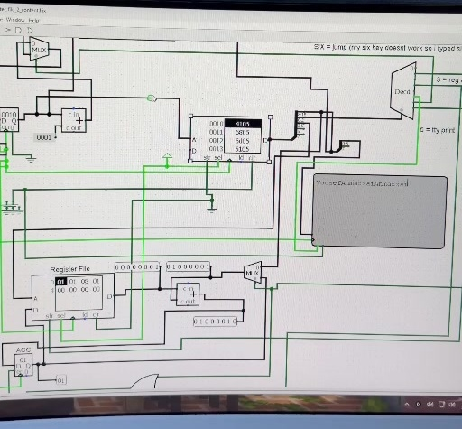
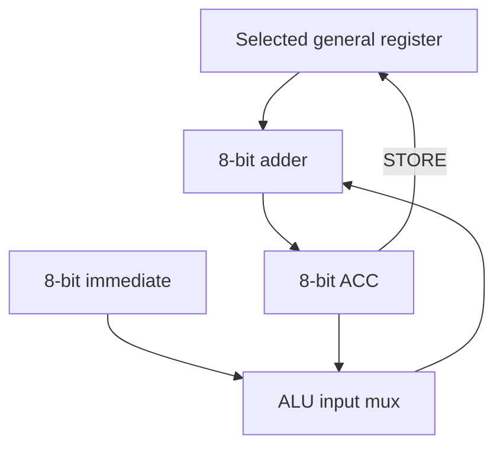

# Logisim CPU with Accumulator and Fibonacci Program

A CPU course project in Logisim with an 8-bit datapath, a separate accumulator, and a custom instruction set. The program prints my name, repeats my surname, updates a register by the surname length, and calculates the next Fibonacci value on each loop.

**Project by Yousef Ahmadzai.**

## Demo

[Download the Part 2 demo](media/videos/part2-demo.mp4)

The recording shows the accumulator-based Part 2 circuit running through its first complete loop. Near the end, Reg-2 contains `08` and Reg-3 contains `01`, and execution returns to the surname loop. Later loop values are listed below as expected results from the program.

## What I worked on

This project builds on earlier fetch, decoder, and register-file assignments. The Part 2 work adds the accumulator and the ALU input multiplexer, connects the instruction decoder to the required control signals, and updates the machine-code program to calculate Fibonacci values.

The accumulator lets the circuit work with two register values even though the register file selects only one address at a time. The two ADD instructions write their result into the accumulator, and a separate STORE instruction copies that result back to a selected register.

## Architecture

| Component | Configuration |
| --- | --- |
| Data path and arithmetic | 8 bits |
| Accumulator | One separate 8-bit register labelled `ACC` |
| General register file | Eight 8-bit values, selected by a 3-bit address |
| Program counter | 16 bits |
| Instruction RAM | 16-bit words with 16-bit addresses |
| Opcode | 3 bits |
| Immediate field | 8 bits |
| Output | TTY character display |
| Circuit file version | Logisim 2.7.1 |

The accumulator datapath is:

## Instruction set

These mnemonics describe the instruction encoding used in this project. The program is supplied as a raw hexadecimal RAM image.

| Opcode | Mnemonic | Operation |
| --- | --- | --- |
| `1` | `ADD Rr` | Add the selected register to ACC; save the result in ACC |
| `3` | `ADDI Rr, imm` | Add the selected register to the immediate; save the result in ACC |
| `5` | `OUT character` | Send the immediate's ASCII character to the TTY |
| `6` | `JMP offset` | Add a signed 8-bit offset to the current program counter |
| `7` | `STORE Rr` | Copy ACC into the selected general register |

See the [instruction encoding and control table](docs/instruction-set.md) and the [complete program listing](docs/program-listing.md).

## Program behavior

1. Print `YousefAhmadzai` once and initialize the Fibonacci state to 0 and 1.
2. Print `Ahmadzai` during each loop.
3. Add 8 to Reg-2, because `Ahmadzai` contains eight characters.
4. Add the previous two Fibonacci values and place the result in Reg-3.
5. Update the saved Fibonacci state and jump back to address `0010`.

| Register | Use |
| --- | --- |
| Reg-0 | Previous Fibonacci value |
| Reg-1 | Current Fibonacci value |
| Reg-2 | Surname character count, increased by 8 per loop |
| Reg-3 | Newly calculated Fibonacci value |

Expected values at completed loops are shown in hexadecimal. The first row is visible in the demo; later rows follow from decoding the RAM program.

| Completed loop | Reg-0 | Reg-1 | Reg-2 | Reg-3 |
| --- | --- | --- | --- | --- |
| 1 | `01` | `01` | `08` | `01` |
| 2 | `01` | `02` | `10` | `02` |
| 3 | `02` | `03` | `18` | `03` |
| 4 | `03` | `05` | `20` | `05` |
| 5 | `05` | `08` | `28` | `08` |
| 6 | `08` | `0D` | `30` | `0D` |

Arithmetic wraps modulo 256 because the data path is 8 bits. See the program listing for the later overflow example.

## Open and run

1. Open [registerFile2_YousefAhmadzai.circ](registerFile2_YousefAhmadzai.circ) in Logisim. The file identifies Logisim 2.7.1 as its source version.
2. Turn automatic ticks off, then choose **Simulate → Reset Simulation**.
3. Right-click the **upper instruction RAM**, choose **Load Image…**, and select [registerFile2_content.hex](registerFile2_content.hex). Load this into the instruction RAM rather than the lower register-file RAM.
4. Choose a tick frequency under **Simulate → Tick Frequency**, then enable **Ticks Enabled**.
5. Watch the TTY, ACC, and register-file values. Increase the tick frequency to see more loop iterations in a shorter time.

Reset before loading the image when starting a fresh run. The RAM image is a separate file and needs to be loaded into the circuit.

The circuit and RAM file retain their original contents. The expected trace was checked against the decoded program; a separate native Logisim simulation was not run for this package. The video documents the first complete loop.

## Assignment requirements

The latest Part 2 instructions supplied with the project are included as [page 1](docs/assignment/part2-requirements-1.png), [page 2](docs/assignment/part2-requirements-2.png), and [page 3](docs/assignment/part2-requirements-3.png).

Logisim references: [memory image loading](https://www.cburch.com/logisim/docs/2.7/en/html/guide/mem/menu.html), [simulation controls](https://www.cburch.com/logisim/docs/2.7/en/html/guide/menu/simulate.html), and [register behavior](https://www.cburch.com/logisim/docs/2.7/en/html/libs/mem/register.html).
